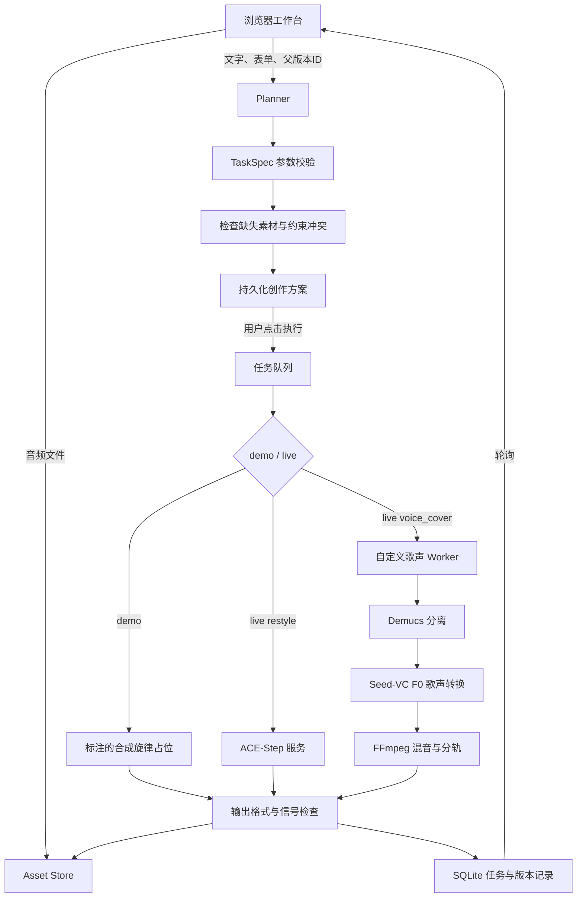

# 架构与开发分工

## 数据与控制流

## 职责边界

- Planner 只生成结构化任务；不能执行模型提供的代码、路径或 URL。
- Engine 负责可观察的任务生命周期，不在其中写模型推理实现。
- Provider 负责供应商协议；网络错误明确返回任务失败。
- GPU Worker 负责音频推理与混音；与 UI、LLM、数据库解耦。
- Store 保存 JSON 记录与服务生成的素材 ID，浏览器不指定服务器文件路径。

## 状态机

`queued → running → succeeded / failed`

`queued / running → canceling → canceled`

每一步单独保存 `pending / running / succeeded / failed / canceled`。执行日志记录可验证的工具状态，不输出模型隐藏推理过程。启动时将之前未完成的任务标记为失败，由用户检查远端任务后再手动提交。

`plan_id` 的重复提交返回同一个 job，避免双击导致重复生成。方案参数由后端保存，执行接口只接受方案 ID。

## 版本语义

- 每个 job 都包含不可变的输入快照和 `parent_job_id`。
- 只能从 `succeeded` 的父版本继续编辑。
- 继承父版本的风格、乐器、歌词、时长等参数；本轮明确要求和表单值覆盖继承值。
- 当前版本作为新的源音频，不修改父版本原文件。
- 本轮 `preserve` 单独规划；不自动把上一次的保留要求变成永久编辑锁。
- 歌声路线使用分离伴奏与原唱 F0；分离伪影、音色相似与对齐需真实评估。
- 已保存裁剪原曲、原唱、转换歌声和伴奏用于试听；尚未实现自动跳过分离的缓存复用。
- 演示台使用独立 showcase 记录引用 job，不改写任务或 demo/live 来源。收藏与回放不调用模型。

## 六人建议分工

| 人员 | 文件边界 | 首周交付 |
| --- | --- | --- |
| A / Agent | `planner.py`、`models.py` | 任务字段与 LLM 解析样例 |
| B / 模型 | `providers/acestep.py` | 部署 ACE-Step 并验证 Cover |
| C / 改编 | Cover 参数与源音频预处理 | 改编参数对照样例 |
| D / 歌声 | 独立 GPU Worker | Demucs → Seed-VC → 混音 |
| E / 集成 | `web/`、`server.py`、`engine.py` | 两条核心流程 UI 与后端联调 |
| F / 评估 | `tests/`、评测数据与报告 | 约 30 条测试任务及评分协议 |

先固定接口，再并行工作。所有成员在自己的分支开发；共享 API Key 不写进版本库。

## 后续迁移

1. 需要生产级请求校验和 OpenAPI 时，把 HTTP 层替换为 FastAPI；保留 Planner、Engine 和 Provider。
2. GPU 长任务需要独立队列时，把 ThreadPoolExecutor 替换为外部任务系统。
3. 多轮规划分支复杂时，用 LangGraph 替换显式工作流。
4. 需要多用户协作时，再引入身份认证、项目隔离、对象存储和访问控制。

这些不是当前版本的依赖，避免首周陷入基础设施搭建。

作曲默认关闭，可显式启用实验入口。Voice Worker 使用内存队列与子进程组取消；GPU 部署及模型效果尚未在目标服务器验证。
